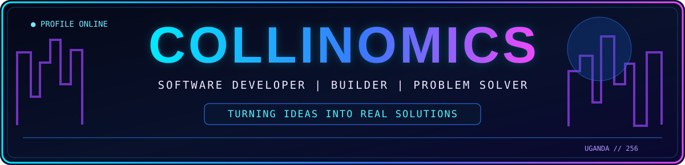
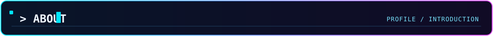
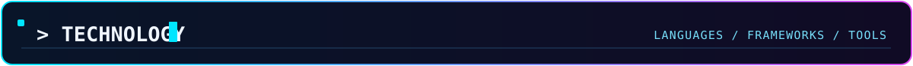
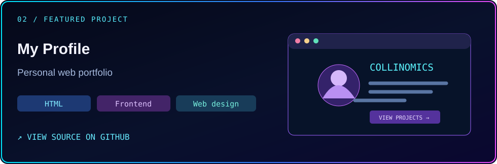
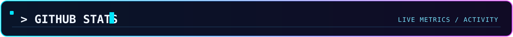

<!-- COLLINOMICS V1 ENHANCED PREVIEW -->

[**PROJECTS ↓**](#-featured-projects) · [**TECHNOLOGY ↓**](#-technology-stack) · [**ACTIVITY ↓**](#-github-statistics)

<table>
<tr>
<td width="62%" valign="top">

<code>&gt; about.init()</code> <b>Collins Muzira / Collinomics</b>

<b>Software developer</b> and <b>ICT student</b> at Kyambogo University, Uganda.

I build <b>web applications</b>, <b>backend systems</b>, and tools that solve practical problems. My interests include campus technology, authentication, databases, and AI-assisted software.

<code>BUILD</code> &nbsp; → &nbsp; <code>LEARN</code> &nbsp; → &nbsp; <code>IMPROVE</code>

<b>Location</b> · Kampala, Uganda <b>Focus</b> · Web apps, APIs, databases <b>Interests</b> · Campus platforms, AI tools, security <b>Status</b> · Open to collaboration

</td>
<td width="38%" valign="middle" align="center">

</td>
</tr>
</table>

<b>01 / LANGUAGES &amp; FRONTEND</b> 

  
<b>02 / FRAMEWORKS &amp; BACKEND</b> 

  
<b>03 / DATA &amp; DEVELOPMENT TOOLS</b> 

<table>
<tr>
<td width="50%" valign="top">

<h4>🎓 KYU AI Course Recommendation &amp; Admissions</h4>

A Python/Flask project exploring course recommendations, admissions workflows and a database-backed application architecture.

<code>Python</code> <code>Flask</code> <code>Database</code>

<a href="https://github.com/Collinomics/kyu-ai-cris"><b>Explore source ↗</b></a>

</td>
<td width="50%" valign="top">

<h4>🌐 My Profile</h4>

A personal website focusing on frontend development and web presentation.

<code>HTML</code> <code>Frontend</code> <code>Web Design</code>

<a href="https://github.com/Collinomics/My-profile"><b>Explore source ↗</b></a>

</td>
</tr>
</table>

Project visuals are original illustrations, not screenshots. Live demo links will be added once verified.

External statistics may sometimes be delayed or unavailable. See the official <a href="https://github.com/Collinomics">GitHub contributions calendar</a>.

<h3 align="center">🐍 Contribution Snake · Animated</h3>

<picture>
<source media="(prefers-color-scheme: dark)" srcset="https://raw.githubusercontent.com/Collinomics/Collinomics/output/github-contribution-grid-snake-dark.svg"/>
<source media="(prefers-color-scheme: light)" srcset="https://raw.githubusercontent.com/Collinomics/Collinomics/output/github-contribution-grid-snake.svg"/>

</picture>
Generated by the existing GitHub Actions workflow.

---

**Interested in building something useful together?**

COLLINOMICS · Uganda 🇺🇬 · Build thoughtfully. Learn continuously. Ship useful work.

