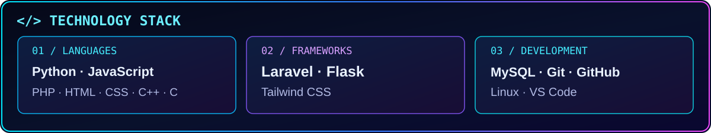

<!-- COLLINOMICS V1 ENHANCED PREVIEW -->

**🇺🇬 Uganda · 💻 Software Developer · 🎓 Kyambogo University**

[**PROJECTS ↓**](#-featured-projects) · [**TECHNOLOGY ↓**](#-technology-stack) · [**ACTIVITY ↓**](#-github-statistics)

<table><tr><td width="52%" valign="top">

### > Hello, World!

I'm **Collins Muzira (Collinomics)**, a software developer and ICT student at **Kyambogo University, Uganda**.

I enjoy building useful web applications, backend systems and practical tools that make complex tasks easier. My interests include campus technology, authentication, databases and AI-assisted software.

**Building. Learning. Improving.**

</td><td width="48%" valign="top">

### > About Me

**Location:** Kampala, Uganda 🇺🇬

**Focus:** Web apps · APIs · Databases

**Interests:** Campus platforms · AI tools · Security

**Currently:** Building projects and expanding my skills

**Collaboration:** Open to useful ideas

</td></tr></table>

### ⚡ Technology Stack

### 🚀 Featured Projects

**KYU AI Course Recommendation & Admissions** — A Python/Flask project exploring course recommendations, admissions workflows and a database-backed application architecture. **[Explore source ↗](https://github.com/Collinomics/kyu-ai-cris)**

**My Profile** — A personal website focusing on frontend development and web presentation. **[Explore source ↗](https://github.com/Collinomics/My-profile)**

Project visuals are original illustrations, not screenshots. Live demo links will be added once verified.

### 📊 GitHub Statistics

External statistics may sometimes be delayed or unavailable. See the official <a href="https://github.com/Collinomics">GitHub contributions calendar</a>.

### 🐍 Contribution Snake

<picture>
<source media="(prefers-color-scheme: dark)" srcset="https://raw.githubusercontent.com/Collinomics/Collinomics/output/github-contribution-grid-snake-dark.svg"/>
<source media="(prefers-color-scheme: light)" srcset="https://raw.githubusercontent.com/Collinomics/Collinomics/output/github-contribution-grid-snake.svg"/>

</picture>
Generated by the existing GitHub Actions workflow.

---

### 🤝 Connect & Collaborate

**Interested in building something useful together?**

COLLINOMICS · Uganda 🇺🇬 · Build thoughtfully. Learn continuously. Ship useful work.

