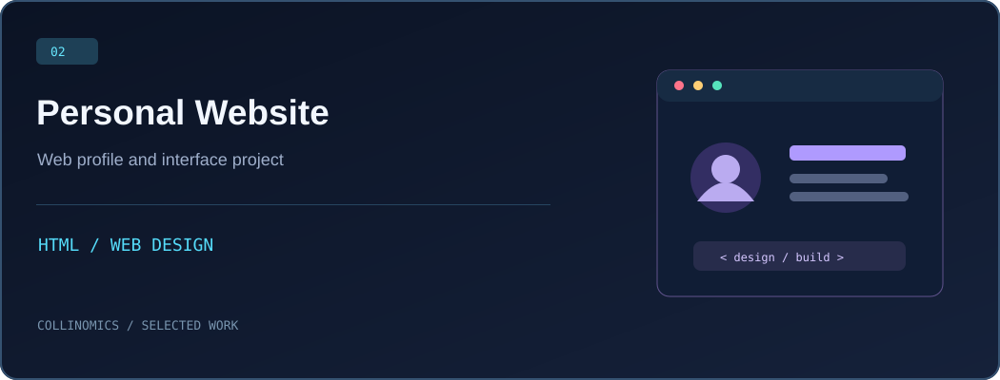

**Building useful web products, backend systems and thoughtful interfaces.**

[Explore my work](#selected-work) · [Technology stack](#technology-stack) · [GitHub activity](#github-activity) · [Get in touch](#connect)

## About

I'm **Collins Muzira**, a software developer and ICT student at **Kyambogo University, Uganda**. I enjoy taking ideas from a rough concept to a working application—from the interface to APIs, data and deployment.

My interests include campus technology, practical AI-powered tools, authentication and real-time applications. I care about understandable code and software that people can actually use.

## Selected work

**KYU AI Course Recommendation & Admissions Information System** — A Flask-based project for course and admissions workflows, with application routes, role-oriented dashboards and a database layer.  
`Python` · `Flask` · `SQLAlchemy` · `Authentication`  
**[Explore the code →](https://github.com/Collinomics/kyu-ai-cris)**

**Personal Website** — An HTML-based web profile project focused on presenting information through a straightforward browser interface.  
`HTML` · `Frontend` · `Web design`  
**[Explore the code →](https://github.com/Collinomics/My-profile)**

Project visuals above are original illustrations, not screenshots of the applications. Demo links will be added when verified deployments are available.

## Technology stack

**Languages** · Python · PHP · JavaScript · C++ · C · SQL  
**Web** · HTML · CSS · Flask · Laravel  
**Tools & data** · Git · GitHub · MySQL · Linux · VS Code

## GitHub activity

My live contribution history is available in the [GitHub contribution calendar](https://github.com/Collinomics#js-contribution-activity). I also maintain a generated contribution snake:

If the animation does not load, [view its generated SVG directly](https://github.com/Collinomics/Collinomics/blob/output/github-contribution-grid-snake.svg).

## Connect

Interested in collaborating on a web app, useful campus tool or backend system? **[Find me on GitHub →](https://github.com/Collinomics)**

Designed with intention · Built in Uganda 🇺🇬

